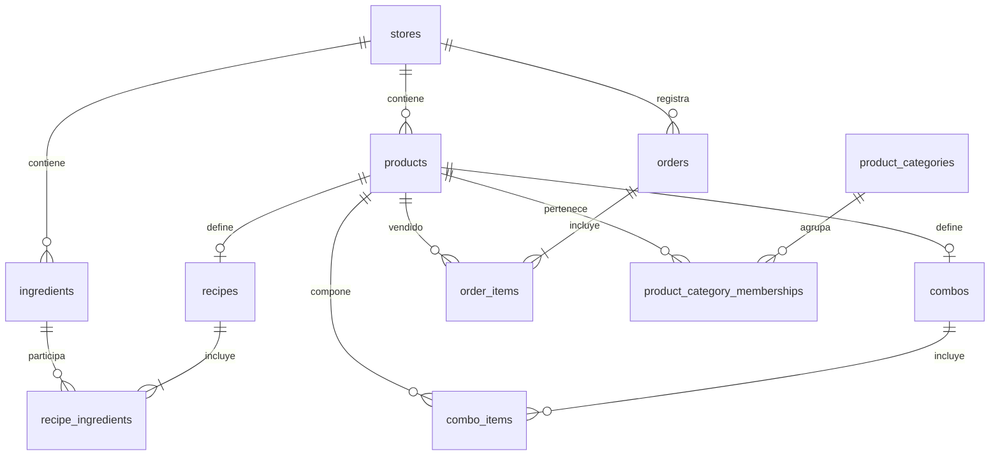

# Diccionario de datos y propuesta de entidades relacionales

Actualizado: 2026-11-07. Fuente: `server/api.ts`, `server/data-blocks.ts`, tipos y servicios de `src/feature/`.

Este documento describe el modelo implementado en archivos JSON y propone su correspondencia con tablas. Los nombres de tablas son propuestas: no hay migraciones SQL ni tablas relacionales creadas por este cambio.

## 1. Organizacion de los datos actuales

Cada base seleccionable contiene un objeto `MockDb`. Sus listas son colecciones JSON, no tablas. Los archivos `db.js` de bases adicionales contienen JSON. El registro externo `mock-api/data-stores.json` identifica la base activa y sus directorios de datos, imagenes y recibos. Con `DATA_ROOT`, esos archivos pueden estar fuera del checkout, por ejemplo en `/data` dentro de Docker.

Una **entidad propietaria** indica el dominio responsable del dato. No equivale necesariamente al bloque de respaldo: por compatibilidad actual, algunas configuraciones comerciales viajan en Operaciones. La tabla de bloques de este documento describe ese comportamiento real.

Los identificadores de productos, ingredientes, recetas, categorias y combos no son intercambiables. `menu:<productId>` es una referencia de transporte usada por las ventas; el prefijo no debe convertirse en otro producto al migrar.

## 2. Coleccion actual, entidad propietaria y tablas propuestas

| Coleccion o ajuste | Entidad propietaria | Informacion principal | Tablas propuestas |
| --- | --- | --- | --- |
| `products` | Catalogo / Producto comercial | Nombre, tipo, precio, costo, imagen, barcode, categorias, referencias a receta/combo | `products`, `product_category_memberships` |
| `productPrices` | Catalogo / Historial de precios | Producto, nuevo precio, costo/margen opcionales y fecha | `product_price_history` |
| `ingredients` | Catalogo / Insumo; saldo pertenece a Inventario | Modalidad, categoria de materia prima, conservacion, porcion; saldo y minimo actuales | `ingredients`, `inventory_balances` o vista de saldo |
| `ingredientCategories` | Catalogo / Categoria de materia prima | Nombre e identificador; Carnes, Panificados, etc. | `ingredient_categories` |
| `recipes` | Catalogo / Receta | Producto elaborado y lista de ingredientes con cantidad y obligatoriedad | `recipes`, `recipe_ingredients` |
| `combos` | Catalogo / Combo | Producto combo, componentes fijos, grupos elegibles y productos permitidos | `combos`, `combo_items`, `combo_option_groups`, `combo_option_products` |
| `categories` | Catalogo / Categoria comercial | Nombre, orden numerico y productos asociados | `product_categories`, `product_category_memberships` |
| `menuProducts` | Compatibilidad de catalogo | Menu antiguo con receta o combo embebido | Staging de migracion; consolidar en products/recipes/combos |
| `menuCategories` | Compatibilidad de catalogo | Categorias del menu antiguo y orden | Staging; consolidar en product_categories |
| `users` | Acceso / Usuario | Identidad, rol, credencial demo y horario | `users`; credenciales seguras o proveedor de identidad |
| `deleteRequests` | Operaciones / Solicitud de baja | Producto solicitado, solicitante, estado y revision | `product_deletion_requests` |
| `requests` | Operaciones / Solicitud operativa | Mercaderia o permisos, items, revision y pedido asociado | `operation_requests`, `operation_request_items` |
| `stocks` | Inventario / Movimiento | Origen, cantidad con signo, unidad, vencimiento, costo total y pedido asociado | `inventory_movements`, futuro `inventory_lots` |
| `orders` | Ventas / Orden | Estado, operador, lineas, cantidades, precios, elecciones y exclusiones | `orders`, `order_items` y tablas hijas indicadas abajo |
| `invoices` | Ventas / Registro de facturacion | Orden, total, metodo, operador y fecha | `invoices` |
| `workdays` | Caja / Jornada | Apertura, ordenes, estado, cierre y revision administrativa | `workdays`, `workday_orders`, `workday_close_summaries`, `workday_reviews` |
| `cashOpeningAssignments` | Caja / Asignacion de apertura | Operador, monto, turno y horario; no posee id propio actualmente | `cash_opening_assignments` |
| `supplyOrders` | Compras / Pedido a proveedor | Proveedor como texto, items, importes esperados/reales, faltantes y evidencia | `purchase_orders`, `purchase_order_items`; futuro `suppliers` |
| `expenses` | Gastos / Gasto confirmado o pendiente | Monto asignado/final, tipo, comprobantes y confirmacion | `expenses`, opcional `expense_attachments` |
| `feedbackEntries` | Operaciones / Sugerencia o reclamo | Mensaje, tipo, autor/rol y anonimato | `feedback_entries` |
| `financialAccounts` | Finanzas / Cuenta derivada | Definicion de cuenta y balance calculado | `financial_accounts`; balance mediante vista o proyeccion |
| `financialTransactions` | Finanzas / Transaccion derivada | Evento de negocio, cuenta, importe, direccion y referencias | `financial_transactions` como proyeccion idempotente |
| `licenses` | Administracion / Licencia o permiso | Datos, contacto, vencimiento, estado y renovaciones | `licenses`, `license_issuances` |
| `notifications` | Notificaciones / Aviso in-app | Tipo, texto, referencia, accion, vencimiento y estado | `notifications` |
| `notificationSettings` | Notificaciones / Configuracion por tipo | Anticipo y duracion de cada tipo | `notification_settings` |
| `stockThresholdSettings` | Inventario / Minimos de producto | Mapa por categoria y excepciones por producto | `category_stock_thresholds`, `product_stock_thresholds` |
| `priceMarginSettings` | Catalogo / Politica de precios | Margenes por categoria/producto e historiales | `category_price_margins`, `product_price_margins`, tablas de historial |
| `paymentMethodSettings` | Comercial / Ajuste por medio de pago | Metodo, descuento y recargo | `payment_method_settings` |
| `taxSettings` | Comercial / Impuesto | Porcentaje IVA y modo de aplicacion | `tax_settings` por base |
| `systemSettings` | Sistema / Politica operativa | `allowOutOfStockSales` | `system_settings` por base |

Los contratos de campos completos, incluidos objetos anidados, aparecen al final. `createdAt` y otras fechas no son automaticamente claves ni registros de auditoria completos.

## 3. Relaciones y significado funcional

### Catalogo e ingredientes

- `products.type`: ingrediente, empaque, bebida, receta o combo. `stockMode` define unidad/peso cuando aplica; `stockType` mantiene compatibilidad. No usar el texto del nombre para identificar el tipo.
- `products.recipeId` / `recipes.productId`: referencias al mismo vinculo producto-receta. El codigo tambien resuelve recetas por productId; consolidar una relacion canonica al migrar.
- `recipes.ingredients[].ingredientId` apunta a ingredients. `quantity` expresa gramos si el ingrediente es por peso, o unidades/paquetes segun su modalidad. `required` pertenece a la participacion del ingrediente en esa receta, no al ingrediente global.
- Sin required se considera obligatorio. Un unico ingrediente siempre es obligatorio aunque un archivo antiguo indique false. Los opcionales solo dejan de consumirse cuando la linea de venta los excluye.
- `ingredients.productId` es opcional. Puede vincular materia prima con un producto almacenado; muchas bases usan solo ingredient.id. No crear productos duplicados para resolver esa ausencia sin una estrategia de migracion.
- `ingredients.categoryId` apunta a ingredientCategories. Su ausencia produce Sin categoria. No apunta a categories: las categorias comerciales organizan productos vendibles.
- `categories.productIds`, `products.categoryIds` y `products.category` duplican asignaciones. La futura tabla de union debe conservar multiples categorias y una categoria principal cuando corresponda.
- `categories.order`: menor primero; empate por nombre. Valores iniciales: Combos 10, Hamburguesas 20, Panchos 30, Bebidas 40, Extras 50, otras 1000. Las preferencias guardadas prevalecen sobre defaults.
- El recorte visual de Hamburguesa en las tarjetas no es un campo de datos ni renombra productos. No hay un ajuste de prefijo por categoria.

### Combos

- `combos.productId` identifica el producto comercial del combo.
- `items[]` contiene productId y quantity de componentes fijos.
- `optionGroups[]` contiene id, name, quantity y productIds permitidos. El id del grupo no equivale necesariamente a una categoria comercial.
- En ventas, `comboSelections[].category` puede transportar el identificador del grupo; no imponer una FK directa a categories sin normalizar este significado.
- La venta conserva el componente elegido. No inferirlo posteriormente desde la configuracion actual del combo.

### Stock, kilos, porciones y costos

- `ingredients.stockQuantity` es saldo persistido; para peso son gramos. La carga actual recibe kg, por ejemplo 2 kg -> 2000 g. El endpoint tambien admite grams para clientes compatibles.
- `portionSizeGrams` permite calcular floor(stockQuantity / portionSizeGrams) y sugiere incrementos en el editor. No multiplica quantity de receta. Una receta de 250 g consume exactamente 250 g.
- `stocks.quantity` se guarda con signo y `movementType` indica in/out. Para comparar cantidades se usa la unidad base; kilos se convierte a gramos. No sumar kilos y gramos sin conversion.
- En el formato actual `stocks.productId` puede identificar un producto o un ingrediente sin producto asociado. Es una referencia polimorfica de hecho, no una FK valida a products en todos los casos.
- `products.existencia` y `ultimoIngreso` se agregan en respuestas de lectura desde stocks; no son campos canonicos del tipo Product del servidor. El enriquecedor actual toma la fecha del ultimo movimiento, sin distinguir estrictamente entradas de salidas.
- Las recetas del dominio actual registran salidas y actualizan saldos de ingredientes. Las estructuras heredadas pueden actualizar solo saldo. Una venta directa de producto vinculado a un ingrediente tampoco garantiza sincronizacion inversa de ambos saldos.
- `purchaseTotal` es el total en ARS de un ingreso, con hasta dos decimales. No es precio por kg. `costPrice` es un dato de costo usado por otros flujos y no debe reinterpretarse como purchaseTotal.
- Si hay purchaseTotal positivo en un ingreso sin supplyOrderId, se genera stock-purchase en la cuenta Gastos. No se crea un movimiento de efectivo de caja por ese ingreso. Una recepcion ligada a pedido proveedor usa su propia fuente financiera para evitar duplicacion.
- No existe allocation del consumo por lote ni FEFO. El vencimiento esta en el movimiento de entrada y nextExpirationDate es un resumen; no se excluye automaticamente stock vencido del saldo disponible.
- minStockQuantity es el minimo visual del ingrediente. stockThresholdSettings dispara avisos de productos, no una alerta completa de ingredientes con lista de recetas afectadas.

### Ordenes, facturas y recibos

- `orders.items[]` conserva nombre, precio unitario, cantidad, componentes y elecciones. Son datos historicos de la venta, no simples referencias al precio actual.
- `excludedIngredients[]` identifica productId, ingredientId e ingredientName. El servidor comprueba pertenencia a la receta y rechaza excluir obligatorios.
- `comboUnits[]` representa configuraciones por unidad de un combo en contratos anteriores. Debe preservarse al importar ventas historicas aunque el editor actual use lineas por configuracion.
- Estados: por pagar -> pagada o cancelada. El stock se descuenta al pagar. Cancelar una pendiente no devuelve stock porque no lo habia consumido. No hay flujo de devolucion de una venta pagada.
- La orden no guarda una version completa de la receta. Actualmente el consumo se resuelve con la receta vigente al pagar; la migracion debe decidir versionado o snapshot de composicion.
- `invoices.orderId` relaciona el registro interno de facturacion con la orden. Este modelo no demuestra integracion con facturacion fiscal externa.
- `Receipt` no aparece como coleccion en MockDb. POST /receipts genera HTML en receiptsDir y devuelve id, orderId, invoiceId, filePath, html y datos del comprobante; el archivo es el artefacto persistido.
- Se propone una tabla futura receipts con metadatos y storageKey, conservando el archivo. filePath local no debe ser la identidad portable del comprobante.

### Caja, compras y finanzas

- workdays.orderIds relaciona jornada y ordenes; operator es hoy un username textual. cashOpeningAssignments usa operator como referencia, sin id propio.
- closeSummary incluye totales, efectivo esperado/declarado y diferencias; adminReview conserva quien reviso, comprobaciones, notas e informe.
- supplyOrders almacena supplierName como texto, no existe una lista actual suppliers. Los importes y cantidades recibidas pertenecen al pedido y sus items.
- expenses es un registro de gasto distinto de stocks.purchaseTotal. No crear otro gasto por la misma compra de stock o duplicaria el egreso.
- financialAccounts y financialTransactions se regeneran al leer/escribir la DB mediante syncFinancialData. No son una segunda fuente editable de operaciones.
- Tipos declarados: stock-purchase, sale-income, sale-cash, sale-tobacco, expense-payment, expense-cash, supply-payment, supply-cash, supply-return, cash-opening y cash-close. Que un tipo este declarado no significa que todos los caminos lo generen actualmente.
- Una operacion puede generar apuntes en diferentes cuentas, por ejemplo venta e ingreso de efectivo. No sumar todos los creditos como ventas ni todos los debitos como compras sin filtrar cuenta/tipo.
- countsInBalance controla si el apunte afecta el balance derivado. El cierre de caja no representa automaticamente un nuevo gasto comercial.
- Los costos directos de stock se regeneran desde stocks. Restaurar solo Operaciones sin su bloque Stock no conserva esos egresos como hechos independientes aunque el respaldo contenga una copia de financialTransactions.

### Acceso y notificaciones

- users.password contiene MD5 para el login demo. Las rutas protegidas en React no equivalen a autorizacion server-side para todos los endpoints. La migracion debe reemplazar este mecanismo, sin copiarlo como politica de autenticacion de produccion.
- notifications.entityType/entityId es una referencia generica a producto, stock, orden, gasto, licencia, etc. Se propone validar la fuente o usar relaciones por dominio/evento.
- notificationSettings se indexa por type; stockThresholdSettings y priceMarginSettings usan mapas y listas, no filas con una estructura uniforme.
- El roadmap multicanal propone entregas, pero no existen hoy tablas/colecciones de email, Telegram o WhatsApp.

## 4. Objetos anidados que conviene separar en tablas

| Ubicacion JSON | Tabla hija propuesta | Padre / referencias |
| --- | --- | --- |
| categories.productIds / products.categoryIds | product_category_memberships | product_id + category_id; marcar principal cuando aplique |
| recipes.ingredients | recipe_ingredients | recipe_id, ingredient_id, quantity_base, required |
| combos.items | combo_items | combo_id, product_id, quantity |
| combos.optionGroups | combo_option_groups | combo_id, id de grupo, name, quantity |
| combos.optionGroups.productIds | combo_option_products | grupo + producto permitido |
| orders.items | order_items | order_id, product_id canonico, nombre/precio/cantidad historicos |
| orders.items.excludedIngredients | order_item_exclusions | order_item_id, componente/producto, ingrediente, nombre historico |
| orders.items.comboItems | order_item_components | order_item_id, producto elegido y cantidad |
| orders.items.comboSelections | order_item_selections | order_item_id, grupo y producto seleccionado |
| orders.items.comboUnits | order_item_combo_units | order_item_id, indice y etiqueta de unidad |
| comboUnits.comboItems / comboSelections | order_unit_components / order_unit_selections | unidad de combo y sus elecciones |
| workdays.orderIds | workday_orders | workday_id + order_id; definir unicidad de orden por jornada |
| workdays.closeSummary / adminReview | workday_close_summaries / workday_reviews | workday_id; preservar snapshot de auditoria |
| requests.items | operation_request_items | request_id, product_id y snapshot de nombre/cantidad |
| supplyOrders.items | purchase_order_items | purchase_order_id, producto, cantidades y vencimiento |
| licenses.issuances | license_issuances | license_id, fechas y notas |
| paymentMethodSettings.methods | payment_method_settings | store_id + method |
| priceMarginSettings.categoryMargins / productMargins | category_price_margins / product_price_margins | categoria/producto y margen |
| priceMarginSettings.*History | category_margin_history / product_margin_history | referencia, margen anterior/nuevo y fecha |
| stockThresholdSettings.categoryThresholds / productThresholds | category_stock_thresholds / product_stock_thresholds | referencia y minimo |

### Relaciones centrales propuestas

Este diagrama representa tablas futuras, no colecciones adicionales ya implementadas.

## 5. Registro de bases, medios y bloques de respaldo

data-stores.json guarda activeStoreId y stores[]. Cada store tiene id, name, dbPath, imagesDir, receiptsDir y createdAt. No forma parte de MockDb. En una DB compartida se propone stores y store_settings; si se mantienen bases fisicas separadas, documentar cual es el registro central.

| Bloque actual | Contenido exacto principal |
| --- | --- |
| Catalogo, UI Productos | products, ingredients sin saldos/minimos/fechas de ingreso y vencimiento, ingredientCategories, recipes, combos, categories, menuCategories, menuProducts, productPrices, priceMarginSettings; imagenes y avisos de producto |
| Operaciones | orders, invoices, workdays, cashOpeningAssignments, supplyOrders, expenses, feedbackEntries, financialAccounts, financialTransactions, deleteRequests, requests, licenses, paymentMethodSettings, taxSettings; recibos y avisos operativos |
| Stock | stocks, stockThresholdSettings, ingredientBalances (id, stockQuantity, minStockQuantity, lastEntryAt, nextExpirationDate); avisos de stock/ingrediente |
| Fuera de esos bloques | users, systemSettings, notificationSettings y registro de bases; se conservan desde el destino/base activa segun el flujo |

Catalogo tambien omite existencia, ultimoIngreso y supplyOrderId de products. Las notificaciones se clasifican por tipo/entidad en server/data-blocks.ts. ingredientBalances es un DTO de respaldo, no una coleccion de la DB.

El respaldo por bloques tiene format=easyfood-blocks, version=1, source, createdAt y blocks. Los medios se transportan como mapas nombre de archivo -> base64 en catalog.media y operations.receipts. No reutilizar esos nombres como tablas de negocio.

POST /admin/data/blocks recibe action export/preview/apply y credenciales admin. Export usa storeId y blocks[]. Preview/apply usa sources[] (block y storeId o content), mas targetStoreId o name para una nueva base. Cada bloque elegido reemplaza sus equivalentes; no mezcla registros. Las referencias se validan antes de aplicar. No se cambia la base activa.

Antes de reemplazar un destino se genera before-blocks-<timestamp>.json. Copiar medios y escribir JSON no es una unica transaccion; el rename atomico se aplica al archivo de DB de ese flujo. Los backups completos antiguos no incluyen archivos externos por defecto.

## 6. Reglas recomendadas para la futura DB

1. **Separacion por base:** si se comparte motor/esquema, incluir store_id en entidades y referencias. Los mismos IDs pueden existir en respaldos de distintas bases; preservar origen o usar un mapa de migracion.
2. **Cantidades:** unidad base explicita por insumo. Usar decimales adecuados para gramos y conversiones; unidades y paquetes requieren enteros en la carga actual. Un paquete no tiene hoy conversion configurable a su contenido.
3. **Dinero:** DECIMAL con al menos dos decimales para importes; no FLOAT. Diferenciar total de compra, costo unitario, precio de venta e impuesto. La precision necesaria del costo por gramo puede superar dos decimales.
4. **Relaciones:** FK a producto, ingrediente, receta, categoria, orden, jornada y proveedor despues de normalizar referencias. Evitar trasladar stocks.productId polimorfico sin resolverlo.
5. **Unicidad:** una receta/combo canonico por producto cuando corresponda; barcode no vacio unico por base; tablas de union sin duplicados; configuraciones por clave natural (metodo, tipo, producto o categoria).
6. **Transacciones:** confirmar pago, validar y descontar materiales, marcar orden y generar sus eventos de forma consistente. Agregar idempotencia y control de concurrencia; el mock actual usa read-modify-write de archivos y no garantiza aislamiento entre cajas.
7. **Historia:** conservar lineas/precios de orden y definir versionado de recetas. No recalcular ventas historicas con precios o composiciones nuevas.
8. **Inventario:** resolver saldo inicial, entradas, consumos, ajustes, mermas y devoluciones en un movimiento canonico. Agregar order_id/line_id a consumos; actualmente las salidas de venta tienen descripcion Venta sin esa FK estructurada.
9. **Lotes:** crear inventory_lots y asignaciones de consumo si se requiere trazabilidad por vencimiento; no tratar nextExpirationDate como inventario por lote ya implementado.
10. **Finanzas:** elegir entre proyeccion regenerable y libro inmutable; definir claves idempotentes por fuente, tipo y cuenta. No importar copias derivadas como nuevas operaciones.
11. **Archivos:** receipts/media con storageKey portable, nombre y store_id. No guardar rutas absolutas del equipo como referencias permanentes.
12. **Bajas y auditoria:** validar referencias antes de borrar o conservar bajas logicas. Hoy existen historicos, relaciones por nombres y referencias incompletas; inventariarlos antes de habilitar FK estrictas.

## 7. Secuencia de migracion propuesta

1. Respaldar bases y medios; trabajar con copia. No ejecutar cambios de esquema sobre la unica copia operativa.
2. Registrar stores/usuarios y conservar IDs originales por base.
3. Importar categorias comerciales y de materia prima por separado, ingredientes y productos.
4. Consolidar menuProducts/menuCategories heredados, recetas, obligatoriedad y combos; deduplicar por IDs/origen, nunca solo por nombre.
5. Verificar asignaciones de categoria y cantidades de recetas: el hecho de que un registro diga weight no demuestra que una cantidad historica de 1 represente una porcion correcta.
6. Conciliar stockQuantity contra movimientos. Si se incorpora un saldo inicial, no volver a sumar los mismos ingresos historicos.
7. Importar operaciones y sus snapshots; resolver referencias faltantes y prefijos menu:.
8. Importar costos de compra, jornadas, gastos y recepciones; regenerar/conciliar proyecciones financieras sin duplicar eventos.
9. Importar avisos y medios. No reenviar alertas historicas al restaurar datos.
10. Comparar cantidades, stock, costos, totales y casos de ventas permitidas/bloqueadas antes de cambiar el sistema activo.

## 8. Contratos completos de campos actuales

Las siguientes tablas reproducen los tipos declarados del servidor. Opcional significa que el campo puede faltar en JSON; no define por si solo un default SQL. Los campos number no distinguen dinero/gramos/unidades: aplicar las reglas de dominio anteriores. Los contratos del cliente pueden agregar campos de presentacion o compatibilidad.

### 8.1. MockDb

| Campo | Tipo declarado | Opcional | Informacion |
| --- | --- | --- | --- |
| `products` | `Product[]` | No | Nombre, tipo, precio, costo, imagen, barcode, categorias, referencias a receta/combo Propietario: Catalogo / Producto comercial. |
| `productPrices` | `ProductPrice[]` | No | Producto, nuevo precio, costo/margen opcionales y fecha Propietario: Catalogo / Historial de precios. |
| `ingredients` | `Ingredient[]` | No | Modalidad, categoria de materia prima, conservacion, porcion; saldo y minimo actuales Propietario: Catalogo / Insumo; saldo pertenece a Inventario. |
| `ingredientCategories` | `IngredientCategory[]` | No | Nombre e identificador; Carnes, Panificados, etc. Propietario: Catalogo / Categoria de materia prima. |
| `recipes` | `Recipe[]` | No | Producto elaborado y lista de ingredientes con cantidad y obligatoriedad Propietario: Catalogo / Receta. |
| `combos` | `Combo[]` | No | Producto combo, componentes fijos, grupos elegibles y productos permitidos Propietario: Catalogo / Combo. |
| `categories` | `Category[]` | No | Nombre, orden numerico y productos asociados Propietario: Catalogo / Categoria comercial. |
| `menuCategories` | `MenuCategory[]` | No | Categorias del menu antiguo y orden Propietario: Compatibilidad de catalogo. |
| `menuProducts` | `MenuProduct[]` | No | Menu antiguo con receta o combo embebido Propietario: Compatibilidad de catalogo. |
| `users` | `AppUserRecord[]` | No | Identidad, rol, credencial demo y horario Propietario: Acceso / Usuario. |
| `deleteRequests` | `DeleteRequest[]` | No | Producto solicitado, solicitante, estado y revision Propietario: Operaciones / Solicitud de baja. |
| `requests` | `OperationRequest[]` | No | Mercaderia o permisos, items, revision y pedido asociado Propietario: Operaciones / Solicitud operativa. |
| `stocks` | `StockEntry[]` | No | Origen, cantidad con signo, unidad, vencimiento, costo total y pedido asociado Propietario: Inventario / Movimiento. |
| `orders` | `Order[]` | No | Estado, operador, lineas, cantidades, precios, elecciones y exclusiones Propietario: Ventas / Orden. |
| `invoices` | `Invoice[]` | No | Orden, total, metodo, operador y fecha Propietario: Ventas / Registro de facturacion. |
| `workdays` | `Workday[]` | No | Apertura, ordenes, estado, cierre y revision administrativa Propietario: Caja / Jornada. |
| `cashOpeningAssignments` | `CashOpeningAssignment[]` | No | Operador, monto, turno y horario; no posee id propio actualmente Propietario: Caja / Asignacion de apertura. |
| `supplyOrders` | `SupplyOrder[]` | No | Proveedor como texto, items, importes esperados/reales, faltantes y evidencia Propietario: Compras / Pedido a proveedor. |
| `expenses` | `Expense[]` | No | Monto asignado/final, tipo, comprobantes y confirmacion Propietario: Gastos / Gasto confirmado o pendiente. |
| `feedbackEntries` | `FeedbackEntry[]` | No | Mensaje, tipo, autor/rol y anonimato Propietario: Operaciones / Sugerencia o reclamo. |
| `financialAccounts` | `FinancialAccount[]` | No | Definicion de cuenta y balance calculado Propietario: Finanzas / Cuenta derivada. |
| `financialTransactions` | `FinancialTransaction[]` | No | Evento de negocio, cuenta, importe, direccion y referencias Propietario: Finanzas / Transaccion derivada. |
| `licenses` | `LicenseRecord[]` | No | Datos, contacto, vencimiento, estado y renovaciones Propietario: Administracion / Licencia o permiso. |
| `notifications` | `NotificationRecord[]` | No | Tipo, texto, referencia, accion, vencimiento y estado Propietario: Notificaciones / Aviso in-app. |
| `notificationSettings` | `NotificationSetting[]` | No | Anticipo y duracion de cada tipo Propietario: Notificaciones / Configuracion por tipo. |
| `stockThresholdSettings` | `StockThresholdSettings` | No | Mapa por categoria y excepciones por producto Propietario: Inventario / Minimos de producto. |
| `priceMarginSettings` | `PriceMarginSettings` | No | Margenes por categoria/producto e historiales Propietario: Catalogo / Politica de precios. |
| `paymentMethodSettings` | `PaymentMethodSettings` | No | Metodo, descuento y recargo Propietario: Comercial / Ajuste por medio de pago. |
| `taxSettings` | `TaxSettings` | No | Porcentaje IVA y modo de aplicacion Propietario: Comercial / Impuesto. |
| `systemSettings` | `SystemSettings` | No | `allowOutOfStockSales` Propietario: Sistema / Politica operativa. |

### 8.2. DataStoresState

| Campo | Tipo declarado | Opcional | Informacion |
| --- | --- | --- | --- |
| `activeStoreId` | `string` | No | Identificador de la base actualmente seleccionada. |
| `stores` | `DataStoreRecord[]` | No | Registro central de bases y sus rutas. |

### 8.3. DataStoreRecord

| Campo | Tipo declarado | Opcional | Informacion |
| --- | --- | --- | --- |
| `id` | `string` | No | Identificador del registro; conservar el origen/base al migrar. |
| `name` | `string` | No | Nombre visible; no es una clave unica por si mismo. |
| `dbPath` | `string` | No | Ruta del JSON de la base. |
| `imagesDir` | `string` | No | Directorio de imagenes de esa base. |
| `receiptsDir` | `string` | No | Directorio de recibos HTML de esa base. |
| `createdAt` | `string` | No | Fecha de creacion, normalmente ISO 8601. |

### 8.4. Receipt

| Campo | Tipo declarado | Opcional | Informacion |
| --- | --- | --- | --- |
| `id` | `string` | No | Identificador del registro; conservar el origen/base al migrar. |
| `orderId` | `string` | No | Referencia a orders.id. |
| `orderCode` | `string` | No | Codigo visible de orden en el comprobante. |
| `invoiceId` | `string` | Si | Referencia al registro interno de facturacion. |
| `createdAt` | `string` | No | Fecha de creacion, normalmente ISO 8601. |
| `operator` | `string` | No | Username del operador; relacion textual en el modelo actual. |
| `paymentMethod` | `PaymentMethod` | No | Metodo de pago declarado. |
| `items` | `ReceiptItem[]` | No | Lista hija; normalizar a tabla de items del padre. |
| `total` | `number` | No | Total registrado de la operacion; no recalcular con precio vigente. |
| `filePath` | `string` | No | Ruta local del HTML generado; no es una clave portable. |
| `html` | `string` | No | Contenido del recibo generado. |

### 8.5. Product

| Campo | Tipo declarado | Opcional | Informacion |
| --- | --- | --- | --- |
| `id` | `string` | No | Identificador del registro; conservar el origen/base al migrar. |
| `name` | `string` | No | Nombre visible; no es una clave unica por si mismo. |
| `price` | `number` | No | Precio de venta del producto en ARS. |
| `costPrice` | `number` | Si | Costo registrado por el flujo comercial; no equivale al total de compra del ingreso. |
| `createdAt` | `string` | No | Fecha de creacion, normalmente ISO 8601. |
| `imageUrl` | `string` | Si | Referencia de imagen; archivo o URL, no contenido binario. |
| `barcode` | `string` | Si | Codigo de barras del producto. |
| `brand` | `string` | Si | Marca comercial opcional. |
| `description` | `string` | Si | Descripcion o comentario del registro. |
| `category` | `string` | Si | Categoria comercial o identificador de grupo segun el contrato. |
| `categoryIds` | `string[]` | Si | Categorias comerciales asociadas al producto. |
| `type` | `"ingrediente" \| "empaque" \| "bebida" \| "receta" \| "combo"` | Si | Clasificacion segun los valores enumerados del tipo. |
| `stockMode` | `"unit" \| "weight"` | Si | Modalidad de control de stock. |
| `stockType` | `"ingrediente" \| "empaque" \| "bebida" \| "receta" \| "combo"` | Si | Clasificacion compatible del origen de stock; se solapa con Product.type. |
| `recipeId` | `string` | Si | Referencia a recipes.id. |
| `comboId` | `string` | Si | Referencia a combos.id. |
| `supplyOrderId` | `string` | Si | Referencia al pedido proveedor asociado. |

### 8.6. ProductPrice

| Campo | Tipo declarado | Opcional | Informacion |
| --- | --- | --- | --- |
| `id` | `string` | No | Identificador del registro; conservar el origen/base al migrar. |
| `productId` | `string` | No | Referencia al producto; stocks admite tambien un ingrediente sin producto vinculado. |
| `newPrice` | `number` | No | Nuevo precio de venta registrado en el historial. |
| `costPrice` | `number` | Si | Costo registrado por el flujo comercial; no equivale al total de compra del ingreso. |
| `marginPercent` | `number` | Si | Porcentaje de margen registrado. |
| `createdAt` | `string` | No | Fecha de creacion, normalmente ISO 8601. |

### 8.7. Ingredient

| Campo | Tipo declarado | Opcional | Informacion |
| --- | --- | --- | --- |
| `id` | `string` | No | Identificador del registro; conservar el origen/base al migrar. |
| `name` | `string` | No | Nombre visible; no es una clave unica por si mismo. |
| `productId` | `string` | Si | Referencia al producto; stocks admite tambien un ingrediente sin producto vinculado. |
| `metric` | `"unit" \| "weight"` | Si | Unidad de entrada o indicador compatible; ver reglas de peso. |
| `categoryId` | `string` | Si | Referencia a ingredientCategories en el ingrediente. |
| `expiresInDays` | `number` | No | Dias de conservacion configurados para el ingrediente. |
| `stockMode` | `IngredientStockMode` | No | Modalidad de control de stock. |
| `stockQuantity` | `number` | No | Saldo actual: gramos para peso; unidades/paquetes en otras modalidades. |
| `minStockQuantity` | `number` | Si | Umbral visual de reposicion del ingrediente. |
| `portionSizeGrams` | `number` | Si | Gramos por porcion orientativa; no multiplica el consumo de receta. |
| `createdAt` | `string` | No | Fecha de creacion, normalmente ISO 8601. |
| `updatedAt` | `string` | Si | Fecha de ultima actualizacion registrada. |
| `lastEntryAt` | `string` | Si | Fecha registrada del ultimo ingreso al ingrediente. |
| `nextExpirationDate` | `string` | Si | Resumen del proximo vencimiento de ingrediente; no asigna consumo a lotes. |

### 8.8. IngredientCategory

| Campo | Tipo declarado | Opcional | Informacion |
| --- | --- | --- | --- |
| `id` | `string` | No | Identificador del registro; conservar el origen/base al migrar. |
| `name` | `string` | No | Nombre visible; no es una clave unica por si mismo. |
| `createdAt` | `string` | No | Fecha de creacion, normalmente ISO 8601. |
| `updatedAt` | `string` | Si | Fecha de ultima actualizacion registrada. |

### 8.9. Recipe

| Campo | Tipo declarado | Opcional | Informacion |
| --- | --- | --- | --- |
| `id` | `string` | No | Identificador del registro; conservar el origen/base al migrar. |
| `productId` | `string` | No | Referencia al producto; stocks admite tambien un ingrediente sin producto vinculado. |
| `ingredients` | `RecipeIngredient[]` | No | Composicion de la receta: ingrediente, cantidad y required. |
| `createdAt` | `string` | No | Fecha de creacion, normalmente ISO 8601. |
| `updatedAt` | `string` | Si | Fecha de ultima actualizacion registrada. |

### 8.10. Combo

| Campo | Tipo declarado | Opcional | Informacion |
| --- | --- | --- | --- |
| `id` | `string` | No | Identificador del registro; conservar el origen/base al migrar. |
| `productId` | `string` | No | Referencia al producto; stocks admite tambien un ingrediente sin producto vinculado. |
| `items` | `ComboFixedItem[]` | No | Lista hija; normalizar a tabla de items del padre. |
| `optionGroups` | `ComboOptionGroup[]` | No | Grupos elegibles del combo y sus productos permitidos. |
| `createdAt` | `string` | No | Fecha de creacion, normalmente ISO 8601. |
| `updatedAt` | `string` | Si | Fecha de ultima actualizacion registrada. |

### 8.11. Category

| Campo | Tipo declarado | Opcional | Informacion |
| --- | --- | --- | --- |
| `order` | `number` | Si | Orden numerico de categoria; menor aparece primero. |
| `id` | `string` | No | Identificador del registro; conservar el origen/base al migrar. |
| `name` | `string` | No | Nombre visible; no es una clave unica por si mismo. |
| `productIds` | `string[]` | No | Identificadores de productos asociados o permitidos segun entidad. |
| `createdAt` | `string` | No | Fecha de creacion, normalmente ISO 8601. |
| `updatedAt` | `string` | Si | Fecha de ultima actualizacion registrada. |

### 8.12. MenuCategory

| Campo | Tipo declarado | Opcional | Informacion |
| --- | --- | --- | --- |
| `order` | `number` | Si | Orden numerico de categoria; menor aparece primero. |
| `id` | `string` | No | Identificador del registro; conservar el origen/base al migrar. |
| `name` | `string` | No | Nombre visible; no es una clave unica por si mismo. |
| `createdAt` | `string` | No | Fecha de creacion, normalmente ISO 8601. |
| `updatedAt` | `string` | Si | Fecha de ultima actualizacion registrada. |

### 8.13. MenuProduct

| Campo | Tipo declarado | Opcional | Informacion |
| --- | --- | --- | --- |
| `id` | `string` | No | Identificador del registro; conservar el origen/base al migrar. |
| `name` | `string` | No | Nombre visible; no es una clave unica por si mismo. |
| `price` | `number` | No | Precio de venta del producto en ARS. |
| `description` | `string` | Si | Descripcion o comentario del registro. |
| `imageUrl` | `string` | Si | Referencia de imagen; archivo o URL, no contenido binario. |
| `category` | `Product["category"]` | Si | Categoria comercial o identificador de grupo segun el contrato. |
| `recipeItems` | `MenuRecipeItem[]` | No | Composicion heredada/adaptada de menu. |
| `kind` | `MenuProductKind` | Si | Clase de menu o cuenta segun entidad. |
| `comboItems` | `MenuComboItem[]` | Si | Componentes elegidos/fijos del combo. |
| `createdAt` | `string` | No | Fecha de creacion, normalmente ISO 8601. |
| `updatedAt` | `string` | Si | Fecha de ultima actualizacion registrada. |

### 8.14. AppUserRecord

| Campo | Tipo declarado | Opcional | Informacion |
| --- | --- | --- | --- |
| `id` | `string` | No | Identificador del registro; conservar el origen/base al migrar. |
| `name` | `string` | No | Nombre visible; no es una clave unica por si mismo. |
| `email` | `string` | No | Correo del usuario. |
| `username` | `string` | No | Nombre de acceso, tambien usado como referencia textual. |
| `role` | `AppUserRole` | Si | Rol de acceso declarado. |
| `password` | `string` | No | Hash MD5 de demo; debe reemplazarse en autenticacion de produccion. |
| `createdAt` | `string` | No | Fecha de creacion, normalmente ISO 8601. |
| `updatedAt` | `string` | No | Fecha de ultima actualizacion registrada. |
| `startHour` | `string` | No | Inicio de horario, en formato horario del sistema. |
| `endHour` | `string` | No | Fin de horario. |

### 8.15. DeleteRequest

| Campo | Tipo declarado | Opcional | Informacion |
| --- | --- | --- | --- |
| `id` | `string` | No | Identificador del registro; conservar el origen/base al migrar. |
| `requestType` | `RequestType` | No | Clase de solicitud operativa o de eliminacion. |
| `title` | `string` | No | Titulo visible del aviso o apunte. |
| `description` | `string` | Si | Descripcion o comentario del registro. |
| `productId` | `string` | Si | Referencia al producto; stocks admite tambien un ingrediente sin producto vinculado. |
| `productName` | `string` | Si | Nombre historico del producto en esta operacion. |
| `requestedBy` | `string` | No | Usuario solicitante. |
| `requestedAt` | `string` | No | Fecha de solicitud. |
| `status` | `RequestStatus` | No | Estado funcional; valores permitidos se declaran en su tipo. |
| `reviewedBy` | `string` | Si | Usuario que reviso. |
| `reviewedAt` | `string` | Si | Fecha de revision. |

### 8.16. OperationRequest

| Campo | Tipo declarado | Opcional | Informacion |
| --- | --- | --- | --- |
| `id` | `string` | No | Identificador del registro; conservar el origen/base al migrar. |
| `requestType` | `OperationRequestType` | No | Clase de solicitud operativa o de eliminacion. |
| `description` | `string` | No | Descripcion o comentario del registro. |
| `items` | `OperationRequestItem[]` | Si | Lista hija; normalizar a tabla de items del padre. |
| `requestedBy` | `string` | No | Usuario solicitante. |
| `requestedAt` | `string` | No | Fecha de solicitud. |
| `status` | `OperationRequestStatus` | No | Estado funcional; valores permitidos se declaran en su tipo. |
| `reviewedBy` | `string` | Si | Usuario que reviso. |
| `reviewedAt` | `string` | Si | Fecha de revision. |
| `supplyOrderId` | `string` | Si | Referencia al pedido proveedor asociado. |
| `supplierMessage` | `string` | Si | Mensaje al proveedor al resolver la solicitud. |
| `reviewComment` | `string` | Si | Comentario de la revision de la solicitud. |

### 8.17. StockEntry

| Campo | Tipo declarado | Opcional | Informacion |
| --- | --- | --- | --- |
| `purchaseTotal` | `number` | Si | Costo total en ARS de este ingreso de stock; hasta dos decimales. |
| `id` | `string` | No | Identificador del registro; conservar el origen/base al migrar. |
| `productId` | `string` | No | Referencia al producto; stocks admite tambien un ingrediente sin producto vinculado. |
| `expirationDate` | `string` | Si | Fecha de vencimiento del lote/documento segun entidad. |
| `movementDate` | `string` | Si | Fecha del movimiento de stock. |
| `quantity` | `number` | No | Cantidad; interpretar unidad base y signo segun entidad. |
| `metric` | `"unit" \| "grams" \| "kilos"` | Si | Unidad de entrada o indicador compatible; ver reglas de peso. |
| `movementType` | `"in" \| "out"` | Si | Entrada in o salida out; quantity se almacena con signo. |
| `description` | `string` | Si | Descripcion o comentario del registro. |
| `supplyOrderId` | `string` | Si | Referencia al pedido proveedor asociado. |
| `costPrice` | `number` | Si | Costo registrado por el flujo comercial; no equivale al total de compra del ingreso. |
| `createdAt` | `string` | No | Fecha de creacion, normalmente ISO 8601. |

### 8.18. Order

| Campo | Tipo declarado | Opcional | Informacion |
| --- | --- | --- | --- |
| `id` | `string` | No | Identificador del registro; conservar el origen/base al migrar. |
| `items` | `OrderItem[]` | No | Lista hija; normalizar a tabla de items del padre. |
| `createdAt` | `string` | No | Fecha de creacion, normalmente ISO 8601. |
| `status` | `OrderStatus` | No | Estado funcional; valores permitidos se declaran en su tipo. |
| `total` | `number` | No | Total registrado de la operacion; no recalcular con precio vigente. |
| `operator` | `string` | No | Username del operador; relacion textual en el modelo actual. |
| `paymentMethod` | `PaymentMethod` | Si | Metodo de pago declarado. |
| `cancelledAt` | `string` | Si | Fecha/hora de cancelacion. |

### 8.19. Invoice

| Campo | Tipo declarado | Opcional | Informacion |
| --- | --- | --- | --- |
| `id` | `string` | No | Identificador del registro; conservar el origen/base al migrar. |
| `orderId` | `string` | No | Referencia a orders.id. |
| `createdAt` | `string` | No | Fecha de creacion, normalmente ISO 8601. |
| `total` | `number` | No | Total registrado de la operacion; no recalcular con precio vigente. |
| `paymentMethod` | `PaymentMethod` | No | Metodo de pago declarado. |
| `operator` | `string` | No | Username del operador; relacion textual en el modelo actual. |

### 8.20. Workday

| Campo | Tipo declarado | Opcional | Informacion |
| --- | --- | --- | --- |
| `id` | `string` | No | Identificador del registro; conservar el origen/base al migrar. |
| `operator` | `string` | No | Username del operador; relacion textual en el modelo actual. |
| `startedAt` | `string` | No | Fecha/hora de apertura de jornada. |
| `endedAt` | `string` | Si | Fecha/hora de cierre de jornada. |
| `orderIds` | `string[]` | No | Ordenes asociadas a la jornada. |
| `status` | `"open" \| "pending-close" \| "closed"` | Si | Estado funcional; valores permitidos se declaran en su tipo. |
| `openingAssignedAmount` | `number` | Si | Monto de apertura asignado. |
| `openingDeclaredAmount` | `number` | Si | Monto de apertura declarado. |
| `openingDifferenceAmount` | `number` | Si | Diferencia entre apertura declarada y asignada. |
| `closeRequestedAt` | `string` | Si | Fecha/hora de solicitud de cierre. |
| `closeSummary` | `WorkdayCloseSummary` | Si | Snapshot de totales y diferencias al cerrar. |
| `adminReview` | `WorkdayAdminReview` | Si | Revision administrativa y comprobaciones de caja. |

### 8.21. CashOpeningAssignment

| Campo | Tipo declarado | Opcional | Informacion |
| --- | --- | --- | --- |
| `operator` | `string` | No | Username del operador; relacion textual en el modelo actual. |
| `amount` | `number` | No | Importe del registro; interpretar asignacion/gasto/transaccion segun entidad. |
| `shift` | `CashShift` | No | Turno diurno o nocturno. |
| `startHour` | `string` | No | Inicio de horario, en formato horario del sistema. |
| `endHour` | `string` | No | Fin de horario. |
| `updatedBy` | `string` | No | Usuario que modifico la configuracion. |
| `updatedAt` | `string` | No | Fecha de ultima actualizacion registrada. |

### 8.22. SupplyOrder

| Campo | Tipo declarado | Opcional | Informacion |
| --- | --- | --- | --- |
| `id` | `string` | No | Identificador del registro; conservar el origen/base al migrar. |
| `supplierName` | `string` | No | Nombre de proveedor como texto; no hay suppliers actual. |
| `description` | `string` | No | Descripcion o comentario del registro. |
| `expectedTotal` | `number` | No | Importe esperado del pedido proveedor. |
| `items` | `SupplyOrderItem[]` | No | Lista hija; normalizar a tabla de items del padre. |
| `createdAt` | `string` | No | Fecha de creacion, normalmente ISO 8601. |
| `createdBy` | `string` | No | Usuario que registro la operacion. |
| `status` | `SupplyOrderStatus` | No | Estado funcional; valores permitidos se declaran en su tipo. |
| `isExactAmount` | `boolean` | Si | Indica si la recepcion coincide con el importe esperado. |
| `actualTotal` | `number` | Si | Importe real al recibir mercaderia. |
| `remainingAmount` | `number` | Si | Diferencia/vuelto entre esperado y real. |
| `receivedAt` | `string` | Si | Fecha de recepcion o resolucion segun entidad. |
| `receivedBy` | `string` | Si | Usuario receptor de mercaderia. |
| `invoiceImageUrl` | `string` | Si | Imagen del comprobante de compra o gasto. |
| `receiveComment` | `string` | Si | Comentario de recepcion y diferencias. |

### 8.23. Expense

| Campo | Tipo declarado | Opcional | Informacion |
| --- | --- | --- | --- |
| `id` | `string` | No | Identificador del registro; conservar el origen/base al migrar. |
| `description` | `string` | No | Descripcion o comentario del registro. |
| `amount` | `number` | No | Importe del registro; interpretar asignacion/gasto/transaccion segun entidad. |
| `assignedAmount` | `number` | No | Importe originalmente asignado al gasto. |
| `expenseType` | `ExpenseType` | No | Gasto recurrente o imprevisto. |
| `invoiceImageUrl` | `string` | Si | Imagen del comprobante de compra o gasto. |
| `unexpectedImageUrl` | `string` | Si | Imagen de evidencia del gasto imprevisto. |
| `createdBy` | `string` | No | Usuario que registro la operacion. |
| `createdAt` | `string` | No | Fecha de creacion, normalmente ISO 8601. |
| `status` | `ExpenseStatus` | No | Estado funcional; valores permitidos se declaran en su tipo. |
| `confirmedAmount` | `number` | Si | Importe final confirmado. |
| `confirmedBy` | `string` | Si | Usuario que confirmo el gasto. |
| `confirmedAt` | `string` | Si | Fecha/hora de confirmacion. |
| `confirmationComment` | `string` | Si | Justificacion del importe final del gasto. |
| `amountMode` | `ExpenseAmountMode` | Si | Confirmacion del importe asignado o de uno diferente. |

### 8.24. FeedbackEntry

| Campo | Tipo declarado | Opcional | Informacion |
| --- | --- | --- | --- |
| `id` | `string` | No | Identificador del registro; conservar el origen/base al migrar. |
| `type` | `FeedbackType` | No | Clasificacion segun los valores enumerados del tipo. |
| `message` | `string` | No | Texto de la sugerencia o reclamo. |
| `isAnonymous` | `boolean` | No | Indica presentacion anonima del feedback; el contrato aun posee campos de autor. |
| `createdAt` | `string` | No | Fecha de creacion, normalmente ISO 8601. |
| `createdBy` | `string` | No | Usuario que registro la operacion. |
| `createdByRole` | `FeedbackAuthorRole` | No | Rol del autor al registrar feedback. |

### 8.25. FinancialAccount

| Campo | Tipo declarado | Opcional | Informacion |
| --- | --- | --- | --- |
| `id` | `string` | No | Identificador del registro; conservar el origen/base al migrar. |
| `code` | `string` | No | Codigo de la cuenta financiera. |
| `name` | `string` | No | Nombre visible; no es una clave unica por si mismo. |
| `kind` | `FinancialAccountKind` | No | Clase de menu o cuenta segun entidad. |
| `description` | `string` | No | Descripcion o comentario del registro. |
| `currentBalance` | `number` | No | Saldo derivado de transacciones que cuentan en balance. |
| `createdAt` | `string` | No | Fecha de creacion, normalmente ISO 8601. |
| `updatedAt` | `string` | No | Fecha de ultima actualizacion registrada. |

### 8.26. FinancialTransaction

| Campo | Tipo declarado | Opcional | Informacion |
| --- | --- | --- | --- |
| `id` | `string` | No | Identificador del registro; conservar el origen/base al migrar. |
| `createdAt` | `string` | No | Fecha de creacion, normalmente ISO 8601. |
| `type` | `FinancialTransactionType` | No | Clasificacion segun los valores enumerados del tipo. |
| `title` | `string` | No | Titulo visible del aviso o apunte. |
| `description` | `string` | No | Descripcion o comentario del registro. |
| `amount` | `number` | No | Importe del registro; interpretar asignacion/gasto/transaccion segun entidad. |
| `direction` | `FinancialDirection` | No | Entrada in o salida out. |
| `entryKind` | `FinancialEntryKind` | No | Debito o credito declarado. |
| `accountId` | `string` | No | Cuenta financiera del apunte. |
| `accountCode` | `string` | No | Codigo de cuenta copiado por el generador. |
| `accountName` | `string` | No | Nombre de cuenta copiado por el generador. |
| `referenceModule` | `FinancialReferenceModule` | No | Modulo de origen del apunte financiero. |
| `referenceId` | `string` | No | Registro de origen; junto al modulo identifica el hecho de negocio. |
| `orderId` | `string` | Si | Referencia a orders.id. |
| `workdayId` | `string` | Si | Referencia a la jornada asociada. |
| `expenseId` | `string` | Si | Referencia al gasto de origen. |
| `supplyOrderId` | `string` | Si | Referencia al pedido proveedor asociado. |
| `invoiceId` | `string` | Si | Referencia al registro interno de facturacion. |
| `paymentMethod` | `PaymentMethod` | Si | Metodo de pago declarado. |
| `actor` | `string` | Si | Usuario asociado al evento financiero cuando se conoce. |
| `countsInBalance` | `boolean` | No | Indica si el apunte modifica el saldo derivado. |

### 8.27. LicenseRecord

| Campo | Tipo declarado | Opcional | Informacion |
| --- | --- | --- | --- |
| `id` | `string` | No | Identificador del registro; conservar el origen/base al migrar. |
| `name` | `string` | No | Nombre visible; no es una clave unica por si mismo. |
| `description` | `string` | No | Descripcion o comentario del registro. |
| `category` | `Product["category"]` | Si | Categoria comercial o identificador de grupo segun el contrato. |
| `issueDate` | `string` | Si | Fecha de expedicion vigente de la licencia. |
| `expirationDate` | `string` | Si | Fecha de vencimiento del lote/documento segun entidad. |
| `durationDays` | `number` | Si | Duracion configurada. |
| `contactEmail` | `string` | Si | Correo de contacto del permiso/licencia. |
| `contactPhone` | `string` | Si | Telefono de contacto del permiso/licencia. |
| `sourceAddress` | `string` | Si | Direccion o procedencia de la licencia. |
| `status` | `LicenseStatus` | No | Estado funcional; valores permitidos se declaran en su tipo. |
| `createdAt` | `string` | No | Fecha de creacion, normalmente ISO 8601. |
| `updatedAt` | `string` | No | Fecha de ultima actualizacion registrada. |
| `issuances` | `LicenseIssuance[]` | No | Historial de emisiones/renovaciones de licencia. |

### 8.28. NotificationRecord

| Campo | Tipo declarado | Opcional | Informacion |
| --- | --- | --- | --- |
| `id` | `string` | No | Identificador del registro; conservar el origen/base al migrar. |
| `type` | `NotificationType` | No | Clasificacion segun los valores enumerados del tipo. |
| `title` | `string` | No | Titulo visible del aviso o apunte. |
| `description` | `string` | No | Descripcion o comentario del registro. |
| `createdAt` | `string` | No | Fecha de creacion, normalmente ISO 8601. |
| `dueAt` | `string` | Si | Fecha/hora prevista para mostrar o atender el aviso. |
| `isFixed` | `boolean` | No | Aviso fijo hasta su resolucion/deshabilitacion. |
| `requiresAction` | `boolean` | No | Indica si el aviso requiere accion. |
| `actionLabel` | `string` | Si | Texto de la accion sugerida por el aviso. |
| `category` | `Product["category"]` | Si | Categoria comercial o identificador de grupo segun el contrato. |
| `entityType` | `string` | Si | Tipo de entidad referenciada por el aviso. |
| `entityId` | `string` | Si | Identificador de la entidad referenciada. |
| `status` | `NotificationStatus` | No | Estado funcional; valores permitidos se declaran en su tipo. |
| `receivedAt` | `string` | Si | Fecha de recepcion o resolucion segun entidad. |
| `disabledAt` | `string` | Si | Fecha/hora de deshabilitacion del aviso. |

### 8.29. NotificationSetting

| Campo | Tipo declarado | Opcional | Informacion |
| --- | --- | --- | --- |
| `type` | `NotificationType` | No | Clasificacion segun los valores enumerados del tipo. |
| `leadDays` | `number` | No | Anticipo en dias para avisos. |
| `durationDays` | `number` | No | Duracion configurada. |

### 8.30. StockThresholdSettings

| Campo | Tipo declarado | Opcional | Informacion |
| --- | --- | --- | --- |
| `categoryThresholds` | `Record<NonNullable<Product["category"]>, number>` | No | Mapa categoria comercial a minimo de stock de producto. |
| `productThresholds` | `StockThresholdByProduct[]` | No | Excepciones de minimo por producto. |

### 8.31. PriceMarginSettings

| Campo | Tipo declarado | Opcional | Informacion |
| --- | --- | --- | --- |
| `categoryMargins` | `Record<NonNullable<Product["category"]>, number>` | No | Mapa categoria comercial a margen porcentual. |
| `productMargins` | `PriceMarginByProduct[]` | No | Excepciones de margen por producto. |
| `categoryMarginHistory` | `CategoryPriceMarginHistoryEntry[]` | No | Historial de cambios de margen por categoria. |
| `productMarginHistory` | `ProductPriceMarginHistoryEntry[]` | No | Historial de cambios de margen por producto. |

### 8.32. PaymentMethodSettings

| Campo | Tipo declarado | Opcional | Informacion |
| --- | --- | --- | --- |
| `methods` | `PaymentMethodAdjustment[]` | No | Configuracion de descuentos y recargos por medio de pago. |

### 8.33. TaxSettings

| Campo | Tipo declarado | Opcional | Informacion |
| --- | --- | --- | --- |
| `ivaPercent` | `number` | No | Porcentaje de IVA configurado. |
| `mode` | `TaxMode` | No | Modo fiscal: agregar al total o mostrar informacion. |

### 8.34. SystemSettings

| Campo | Tipo declarado | Opcional | Informacion |
| --- | --- | --- | --- |
| `allowOutOfStockSales` | `boolean` | No | Permite omitir el bloqueo por falta de existencias; no omite reglas de composicion. |

### 8.35. PaymentMethod

Valores o forma declarada: `"efectivo" \| "tarjeta debito" \| "tarjeta credito" \| "mercadopago"`.

### 8.36. ReceiptItem

| Campo | Tipo declarado | Opcional | Informacion |
| --- | --- | --- | --- |
| `excludedIngredients` | `OrderItem["excludedIngredients"]` | Si | Ingredientes opcionales omitidos en esta linea de venta. |
| `productId` | `string` | No | Referencia al producto; stocks admite tambien un ingrediente sin producto vinculado. |
| `productName` | `string` | No | Nombre historico del producto en esta operacion. |
| `unitPrice` | `number` | No | Precio unitario historico de la linea de venta. |
| `quantity` | `number` | No | Cantidad; interpretar unidad base y signo segun entidad. |
| `comboItems` | `Array<{ menuProductId: string; menuProductName: string; quantity: number }>` | Si | Componentes elegidos/fijos del combo. |
| `comboSelections` | `Array<{ category: NonNullable<Product["category"]>; menuProductId: string; menuProductName: string }>` | Si | Elecciones de grupos; category puede ser ID de grupo. |
| `comboUnits` | `Array<{ label: string; comboItems: Array<{ menuProductId: string; menuProductName: string; quantity: number }>; comboSelections?: Array<{ category: NonNullable<Product["category"]>; menuProductId: string; menuProductName: string }> }>` | Si | Configuraciones por unidad de combo; preservar al migrar historicos. |

### 8.37. IngredientStockMode

Valores o forma declarada: `"weight" \| "package" \| "unit"`.

### 8.38. RecipeIngredient

| Campo | Tipo declarado | Opcional | Informacion |
| --- | --- | --- | --- |
| `required` | `boolean` | Si | Obligatoriedad en esta receta; ausencia o receta unica se tratan como obligatorio. |
| `ingredientId` | `string` | No | Referencia a ingredients.id. |
| `quantity` | `number` | No | Cantidad; interpretar unidad base y signo segun entidad. |

### 8.39. ComboFixedItem

| Campo | Tipo declarado | Opcional | Informacion |
| --- | --- | --- | --- |
| `productId` | `string` | No | Referencia al producto; stocks admite tambien un ingrediente sin producto vinculado. |
| `quantity` | `number` | No | Cantidad; interpretar unidad base y signo segun entidad. |

### 8.40. ComboOptionGroup

| Campo | Tipo declarado | Opcional | Informacion |
| --- | --- | --- | --- |
| `id` | `string` | No | Identificador del registro; conservar el origen/base al migrar. |
| `name` | `string` | No | Nombre visible; no es una clave unica por si mismo. |
| `quantity` | `number` | No | Cantidad; interpretar unidad base y signo segun entidad. |
| `productIds` | `string[]` | No | Identificadores de productos asociados o permitidos segun entidad. |

### 8.41. MenuRecipeItem

| Campo | Tipo declarado | Opcional | Informacion |
| --- | --- | --- | --- |
| `required` | `boolean` | Si | Obligatoriedad en esta receta; ausencia o receta unica se tratan como obligatorio. |
| `ingredientId` | `string` | No | Referencia a ingredients.id. |
| `ingredientName` | `string` | No | Nombre de ingrediente, incluido en receta adaptada o snapshot de exclusion. |
| `quantity` | `number` | No | Cantidad; interpretar unidad base y signo segun entidad. |
| `stockMode` | `IngredientStockMode` | No | Modalidad de control de stock. |

### 8.42. MenuProductKind

Valores o forma declarada: `"menu" \| "combo"`.

### 8.43. MenuComboItem

| Campo | Tipo declarado | Opcional | Informacion |
| --- | --- | --- | --- |
| `type` | `"product" \| "category"` | No | Clasificacion segun los valores enumerados del tipo. |
| `menuProductId` | `string` | Si | Producto de menu/componente; normalizar al producto canonico. |
| `menuProductName` | `string` | Si | Nombre del componente registrado en menu o venta. |
| `category` | `Product["category"]` | Si | Categoria comercial o identificador de grupo segun el contrato. |
| `categoryName` | `string` | Si | Nombre visible de categoria o grupo de opciones. |
| `allowedMenuProductIds` | `string[]` | Si | Productos elegibles para un grupo heredado. |
| `quantity` | `number` | No | Cantidad; interpretar unidad base y signo segun entidad. |

### 8.44. AppUserRole

Valores o forma declarada: `"admin" \| "operator" \| "terminal"`.

### 8.45. RequestType

Valores o forma declarada: `"product-delete" \| "operation-order"`.

### 8.46. RequestStatus

Valores o forma declarada: `"pending" \| "approved" \| "rejected"`.

### 8.47. OperationRequestType

Valores o forma declarada: `"merchandise" \| "permissions"`.

### 8.48. OperationRequestItem

| Campo | Tipo declarado | Opcional | Informacion |
| --- | --- | --- | --- |
| `productId` | `string` | No | Referencia al producto; stocks admite tambien un ingrediente sin producto vinculado. |
| `productName` | `string` | No | Nombre historico del producto en esta operacion. |
| `quantity` | `number` | No | Cantidad; interpretar unidad base y signo segun entidad. |
| `barcode` | `string` | Si | Codigo de barras del producto. |
| `brand` | `string` | Si | Marca comercial opcional. |
| `category` | `Product["category"]` | Si | Categoria comercial o identificador de grupo segun el contrato. |

### 8.49. OperationRequestStatus

Valores o forma declarada: `"pending" \| "approved" \| "rejected"`.

### 8.50. OrderItem

| Campo | Tipo declarado | Opcional | Informacion |
| --- | --- | --- | --- |
| `excludedIngredients` | `Array<{ productId: string; ingredientId: string; ingredientName: string }>` | Si | Ingredientes opcionales omitidos en esta linea de venta. |
| `productId` | `string` | No | Referencia al producto; stocks admite tambien un ingrediente sin producto vinculado. |
| `productName` | `string` | No | Nombre historico del producto en esta operacion. |
| `unitPrice` | `number` | No | Precio unitario historico de la linea de venta. |
| `quantity` | `number` | No | Cantidad; interpretar unidad base y signo segun entidad. |
| `comboItems` | `Array<{ menuProductId: string; menuProductName: string; quantity: number }>` | Si | Componentes elegidos/fijos del combo. |
| `comboSelections` | `Array<{ category: NonNullable<Product["category"]>; menuProductId: string; menuProductName: string }>` | Si | Elecciones de grupos; category puede ser ID de grupo. |
| `comboUnits` | `Array<{ label: string; comboItems: Array<{ menuProductId: string; menuProductName: string; quantity: number }>; comboSelections?: Array<{ category: NonNullable<Product["category"]>; menuProductId: string; menuProductName: string }> }>` | Si | Configuraciones por unidad de combo; preservar al migrar historicos. |

### 8.51. OrderStatus

Valores o forma declarada: `"por pagar" \| "pagada" \| "cancelada"`.

### 8.52. WorkdayCloseSummary

| Campo | Tipo declarado | Opcional | Informacion |
| --- | --- | --- | --- |
| `totalSales` | `number` | No | Total de ventas de la jornada al cerrar. |
| `totalByPaymentMethod` | `Record<PaymentMethod, number>` | No | Totales de venta por medio de pago. |
| `cashSales` | `number` | No | Ventas en efectivo de la jornada. |
| `totalExpenses` | `number` | No | Gastos considerados en el cierre. |
| `totalSupplyReturns` | `number` | No | Vuelto de recepciones considerado en el cierre. |
| `expectedClosingCash` | `number` | No | Efectivo esperado segun movimientos de jornada. |
| `declaredClosingCash` | `number` | No | Efectivo declarado al cerrar. |
| `closingDifference` | `number` | No | Diferencia entre efectivo declarado y esperado. |
| `balanceTotal` | `number` | No | Balance consolidado del resumen de cierre. |

### 8.53. WorkdayAdminReview

| Campo | Tipo declarado | Opcional | Informacion |
| --- | --- | --- | --- |
| `reviewedBy` | `string` | No | Usuario que reviso. |
| `reviewedAt` | `string` | No | Fecha de revision. |
| `checks` | `WorkdayAuditChecks` | No | Comprobaciones manuales de la auditoria. |
| `notes` | `string` | Si | Notas administrativas o de emision de licencia. |
| `mismatchReport` | `string` | Si | Informe de diferencias del cierre. |

### 8.54. CashShift

Valores o forma declarada: `"diurno" \| "nocturno"`.

### 8.55. SupplyOrderItem

| Campo | Tipo declarado | Opcional | Informacion |
| --- | --- | --- | --- |
| `productId` | `string` | No | Referencia al producto; stocks admite tambien un ingrediente sin producto vinculado. |
| `productName` | `string` | No | Nombre historico del producto en esta operacion. |
| `quantity` | `number` | No | Cantidad; interpretar unidad base y signo segun entidad. |
| `barcode` | `string` | Si | Codigo de barras del producto. |
| `brand` | `string` | Si | Marca comercial opcional. |
| `category` | `Product["category"]` | Si | Categoria comercial o identificador de grupo segun el contrato. |
| `receivedQuantity` | `number` | Si | Cantidad efectivamente recibida del item de compra. |
| `missingQuantity` | `number` | Si | Cantidad faltante del item de compra. |
| `expirationDate` | `string` | Si | Fecha de vencimiento del lote/documento segun entidad. |

### 8.56. SupplyOrderStatus

Valores o forma declarada: `"pending" \| "received"`.

### 8.57. ExpenseType

Valores o forma declarada: `"recurrent" \| "unexpected"`.

### 8.58. ExpenseStatus

Valores o forma declarada: `"pending-confirmation" \| "confirmed"`.

### 8.59. ExpenseAmountMode

Valores o forma declarada: `"assigned" \| "different"`.

### 8.60. FeedbackType

Valores o forma declarada: `"suggestion" \| "claim"`.

### 8.61. FeedbackAuthorRole

Valores o forma declarada: `"admin" \| "operator"`.

### 8.62. FinancialAccountKind

Valores o forma declarada: `"asset" \| "income" \| "expense" \| "category"`.

### 8.63. FinancialTransactionType

Valores o forma declarada: `\| "stock-purchase" \| "sale-income" \| "sale-cash" \| "sale-tobacco" \| "expense-payment" \| "expense-cash" \| "supply-payment" \| "supply-cash" \| "supply-return" \| "cash-opening" \| "cash-close"`.

### 8.64. FinancialDirection

Valores o forma declarada: `"in" \| "out"`.

### 8.65. FinancialEntryKind

Valores o forma declarada: `"debit" \| "credit"`.

### 8.66. FinancialReferenceModule

Valores o forma declarada: `"sale" \| "expense" \| "cash" \| "supply" \| "stock" \| "system"`.

### 8.67. LicenseStatus

Valores o forma declarada: `"active" \| "pending-renewal" \| "expired"`.

### 8.68. LicenseIssuance

| Campo | Tipo declarado | Opcional | Informacion |
| --- | --- | --- | --- |
| `id` | `string` | No | Identificador del registro; conservar el origen/base al migrar. |
| `issuedAt` | `string` | No | Fecha de emision de una renovacion. |
| `expiresAt` | `string` | No | Vencimiento de esa renovacion. |
| `createdAt` | `string` | No | Fecha de creacion, normalmente ISO 8601. |
| `notes` | `string` | Si | Notas administrativas o de emision de licencia. |

### 8.69. NotificationType

Valores o forma declarada: `\| "license-required" \| "license-expiring" \| "product-expiring" \| "product-low-stock" \| "expense-created" \| "sale-created" \| "supply-requested" \| "supply-approved" \| "supply-received" \| "supply-pending-receive" \| "cash-opened" \| "cash-closed" \| "cash" \| "user-created" \| "user-updated" \| "user-deleted" \| "price-changed" \| "product-created" \| "stock-created" \| "operation-request-merchandise" \| "operation-request-permissions" \| "operation-request-reviewed" \| "manual-fixed" \| "manual-action" \| "manual-due"`.

### 8.70. NotificationStatus

Valores o forma declarada: `"active" \| "disabled" \| "received"`.

### 8.71. StockThresholdByProduct

| Campo | Tipo declarado | Opcional | Informacion |
| --- | --- | --- | --- |
| `productId` | `string` | No | Referencia al producto; stocks admite tambien un ingrediente sin producto vinculado. |
| `minUnits` | `number` | No | Minimo por producto en su unidad base. |

### 8.72. PriceMarginByProduct

| Campo | Tipo declarado | Opcional | Informacion |
| --- | --- | --- | --- |
| `productId` | `string` | No | Referencia al producto; stocks admite tambien un ingrediente sin producto vinculado. |
| `marginPercent` | `number` | No | Porcentaje de margen registrado. |

### 8.73. CategoryPriceMarginHistoryEntry

| Campo | Tipo declarado | Opcional | Informacion |
| --- | --- | --- | --- |
| `id` | `string` | No | Identificador del registro; conservar el origen/base al migrar. |
| `category` | `NonNullable<Product["category"]>` | No | Categoria comercial o identificador de grupo segun el contrato. |
| `previousMarginPercent` | `number` | No | Margen anterior; puede ser null en un override nuevo. |
| `marginPercent` | `number` | No | Porcentaje de margen registrado. |
| `createdAt` | `string` | No | Fecha de creacion, normalmente ISO 8601. |

### 8.74. ProductPriceMarginHistoryEntry

| Campo | Tipo declarado | Opcional | Informacion |
| --- | --- | --- | --- |
| `id` | `string` | No | Identificador del registro; conservar el origen/base al migrar. |
| `productId` | `string` | No | Referencia al producto; stocks admite tambien un ingrediente sin producto vinculado. |
| `previousMarginPercent` | `number \| null` | No | Margen anterior; puede ser null en un override nuevo. |
| `marginPercent` | `number \| null` | No | Porcentaje de margen registrado. |
| `createdAt` | `string` | No | Fecha de creacion, normalmente ISO 8601. |

### 8.75. PaymentMethodAdjustment

| Campo | Tipo declarado | Opcional | Informacion |
| --- | --- | --- | --- |
| `method` | `PaymentMethod` | No | Metodo de pago al que aplica el ajuste. |
| `discountPercent` | `number` | No | Descuento porcentual de ese medio. |
| `surchargePercent` | `number` | No | Recargo porcentual de ese medio. |

### 8.76. TaxMode

Valores o forma declarada: `"add_to_total" \| "show_only"`.

### 8.77. WorkdayAuditChecks

| Campo | Tipo declarado | Opcional | Informacion |
| --- | --- | --- | --- |
| `openingAmount` | `boolean` | No | Comprobacion manual de apertura. |
| `cashSales` | `boolean` | No | Comprobacion manual de ventas en efectivo. |
| `expenses` | `boolean` | No | Comprobacion manual de gastos. |
| `supplyReturns` | `boolean` | No | Comprobacion manual de vueltos de compras. |
| `balance` | `boolean` | No | Comprobacion manual de balance. |
